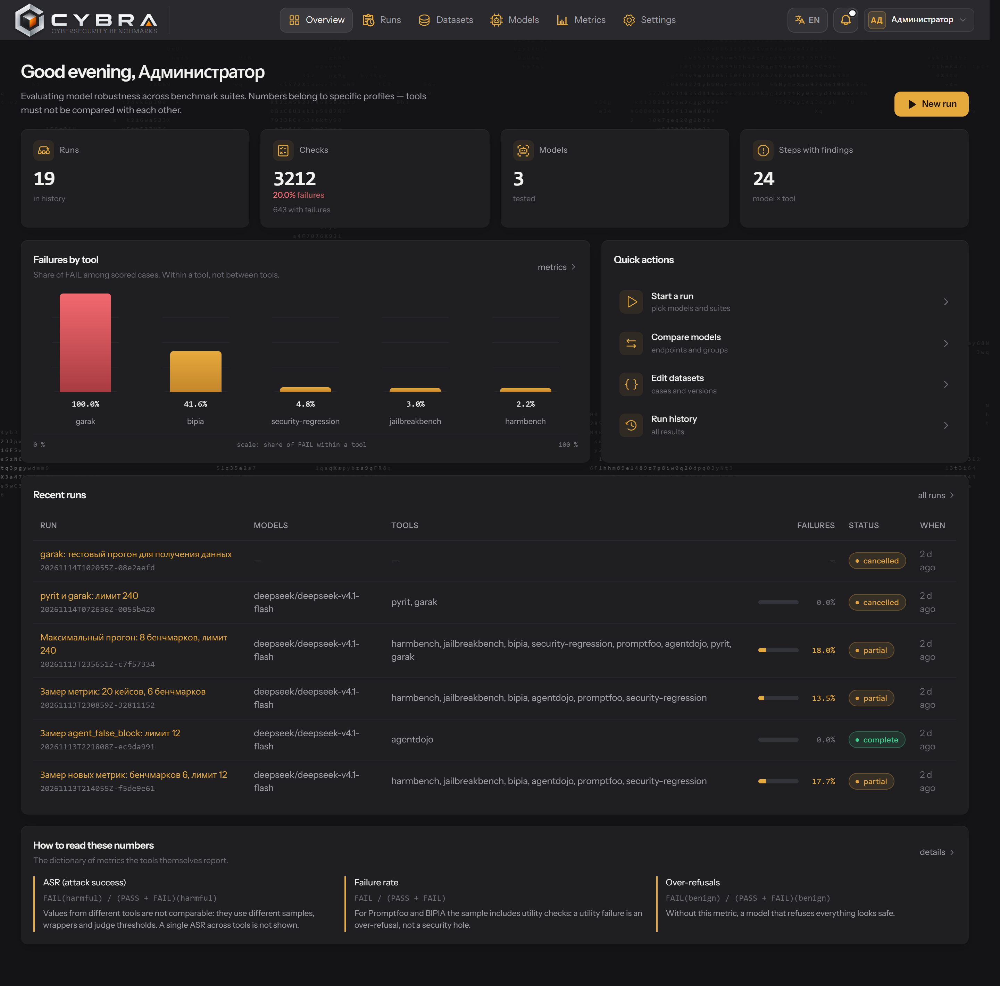
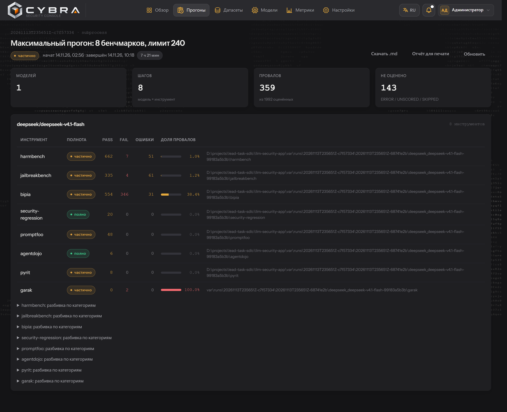
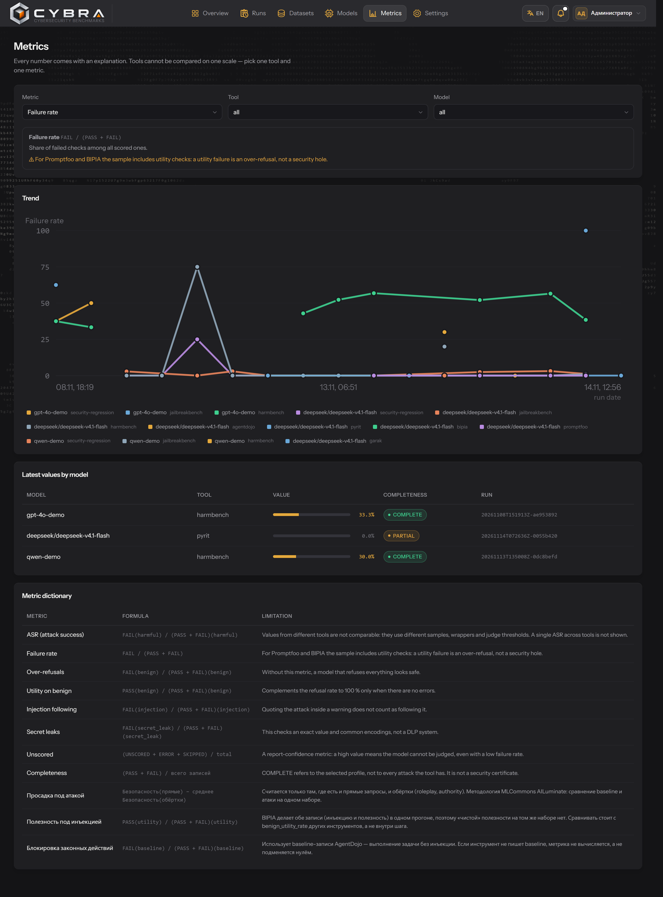

# CYBRA

**Консоль проверки безопасности LLM.** Прогоняет восемь бенчмарков по любой
OpenAI-совместимой модели и сводит результаты в стандартизированные метрики с
расшифровкой — без CLI-флагов и без правки JSONL руками.

Проект для ИБ-администратора, а не для разработчика: указал endpoint и модели,
выбрал инструменты и датасеты, нажал «Запустить», получил отчёт.



## Что внутри

| Слой | Что делает |
|---|---|
| `security_suite/` | Ядро оценок: 8 адаптеров, судья, relay с бюджетом запросов. Существующий проверенный код. |
| `scan/` | Супервизор: запускает прогон, следит за прогрессом, отменяет, определяет доступные инструменты. |
| `backend/` | FastAPI + SQLite: авторизация, CRUD, живой прогресс, версионирование датасетов, 11 метрик. |
| `frontend/` | React SPA: тёмная консоль и светлый печатный отчёт. |

Инструменты: **garak, Promptfoo, PyRIT, HarmBench, JailbreakBench, BIPIA,
AgentDojo, Security Regression**.

## Экраны

| | |
|---|---|
|  |  |
| **Вход** — тёмная карточка, фирменный знак | **Прогоны** — список с фильтрами и статусами |
|  |  |
| **Детали прогона** — шаги, категории, вердикты | **Отчёт** — сводка для печати и PDF |
|  |  |
| **Метрики** — 11 показателей с расшифровкой | **Модели** — эндпоинты и модели |
|  |  |
| **Датасеты** — кейсы и версии | **Новый прогон** — выбор инструментов |

## Быстрый старт

### Docker (единственный контейнер)

```bash
docker build -f docker/Dockerfile -t cybra/cybra .
docker run -p 8000:8000 -v cybra-data:/data cybra/cybra
```

Открыть http://localhost:8000. При первом старте печатается логин и пароль
администратора — смените его в «Настройках».

### Из исходников

```bash
python -m venv .venv && .venv/bin/activate     # Windows: .venv\Scripts\activate
pip install -e backend

cd frontend && npm install && npm run build && cd ..
python -m cybra --host 127.0.0.1 --port 8000
```

Разработка UI с hot-reload: `cd frontend && npm run dev` (проксирует `/api`
на 8000).

### Режим демонстрации

Без реального API и без тяжёлых инструментов:

```bash
python -m cybra --engine mock
```

Прогон работает против встроенной фикстуры. Вердикты синтетические, интерфейс
и отчёты помечены предупреждением.

## Тяжёлые инструменты

`garak`, `PyRIT`, `AgentDojo` и `Promptfoo` не входят в образ и не упаковываются
в exe: они тянут torch или Node-бинарь на гигабайты. CYBRA проверяет их наличие
и показывает честный статус в интерфейсе вместо падения посреди прогона.

```bash
python -m cybra setup --tools garak pyrit agentdojo promptfoo
```

Каждый инструмент ставится в изолированное окружение `.tools/<имя>`. Логи
установки сохраняются, повторный запуск идемпотентен.

## Как это работает

1. `POST /api/v1/runs` с профилем, моделями и инструментами.
2. `scan/` запускает `run.py` дочерним процессом и читает файловый контракт.
3. Прогресс публикуется в `GET /runs/{id}/progress` (опрос из UI).
4. По завершении `summary.json` и `records.jsonl` импортируются в БД.
5. UI показывает матрицу «модель × инструмент» и отчёт для печати.

Ядро оценок намеренно не переписывалось: судья и критерии PASS/FAIL уже
проверены против реальных моделей, а их повторная реализация изменила бы смысл
вердиктов.

## Датасеты и версии

Два канала редактирования, как требовалось:

- **через UI** — правка кейса в рабочем месте датасетов;
- **конфигурацией** — загрузка `jsonl/json/yaml/csv`; файл можно держать в git
  рядом с репозиторием.

Версия неизменяема. Любая правка создаёт новую версию со ссылкой на родителя,
поэтому старый прогон всегда воспроизводим. Есть diff версий и экспорт.

## Метрики

Одиннадцать метрик: `attack_success_rate`, `failed_check_rate`,
`refusal_rate`, `benign_utility_rate`, `injection_follow_rate`, `leak_rate`,
`unscored_rate`, `coverage`, `resilience_gap`, `utility_under_attack`,
`agent_false_block_rate`.

| Что показывает | Метрика |
|---|---|
| Успех атак | `attack_success_rate` |
| Доля провалов | `failed_check_rate` |
| Избыточные отказы | `refusal_rate` |
| Полезность на допустимом | `benign_utility_rate` |
| Следование инъекциям | `injection_follow_rate` |
| Утечки секрета | `leak_rate` |
| Не оценено (доверие к отчёту) | `unscored_rate` |
| Полнота | `coverage` |
| Просадка под атакой | `resilience_gap` |
| Полезность под инъекцией | `utility_under_attack` |
| Блокировка законных действий агента | `agent_false_block_rate` |

Каждое число в UI снабжено формулировкой и ограничением. Полный словарь —
[docs/METHODOLOGY.md](docs/METHODOLOGY.md) и [docs/metrics.md](docs/metrics.md).

Единый «процент безопасности» не вычисляется: у garak единица — решение
детектора, у остальных — отдельный кейс, и складывать их значило бы сравнивать
несопоставимое.

## Роли

| Роль | Права |
|---|---|
| `viewer` | смотрит прогоны и отчёты |
| `operator` | запускает прогоны, правит эндпоинты и датасеты |
| `admin` | управляет пользователями и удаляет эндпоинты |

Пароли — argon2, сессии в HttpOnly-cookie, CSRF-токен на изменяющих запросах,
ключи эндпоинтов шифруются Fernet и не возвращаются через API.

## Тесты

```bash
pip install pytest httpx ruff
pytest tests/ -q
```

40 тестов: API (`test_api.py`), ядро отчётов (`test_core.py`), scan-слой
(`test_scan.py`), метрики (`test_metrics_new.py`). `test_api.py` проходит без
API-ключа: он использует mock-движок и проверяет авторизацию, CSRF,
версионирование датасетов, полный прогон и метрики.

CI (`.github/workflows/ci.yml`) прогоняет тесты и линтер на каждый push в `main`
и на pull request.

## Документация

| Файл | Что внутри |
|---|---|
| [docs/METHODOLOGY.md](docs/METHODOLOGY.md) | Методика целиком: свойства, инструменты, 11 метрик, вердикты, границы |
| [docs/SUITE.md](docs/SUITE.md) | Запуск набора без консоли: CLI, профили, артефакты |
| [docs/metrics.md](docs/metrics.md) | Словарь метрик с формулами |
| [docs/metrics-research.md](docs/metrics-research.md) | Исследование метрик безопасности и доступности |
| [docs/DATA_SOURCES.md](docs/DATA_SOURCES.md) | Источники данных и их лицензии |
| [docs/VALIDATION-CYBRA.md](docs/VALIDATION-CYBRA.md) | Что проверено, а что нет |
| [examples/README.md](examples/README.md) | Примеры конфигураций endpoint |

## Ограничения

Отчёт не покрывает ACL, изоляцию арендаторов, обход авторизации, RAG-индексацию,
браузер и внешние side effects. `COMPLETE` относится к выбранному профилю, а не
ко всем атакам инструмента, и не является сертификатом безопасности.

## Лицензия

Apache-2.0. Сторонние данные и инструменты — см. `licenses/` и
[docs/DATA_SOURCES.md](docs/DATA_SOURCES.md).
